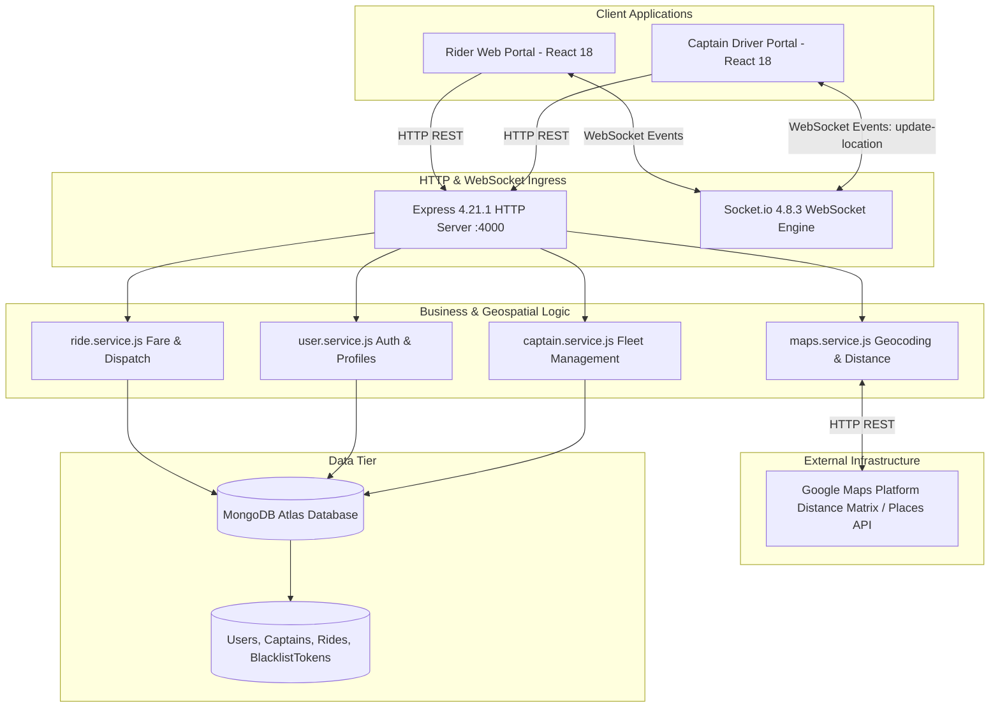

# Full Project Analysis: Real-Time Mobility & Ride-Hailing Platform

## 0.1 What the Project Is
The **Real-Time Mobility & Ride-Hailing Platform** is an end-to-end urban transportation dispatch system modeling the core architecture of services like Uber and Lyft.

It connects two distinct stakeholder personas—**Riders** who request point-to-point transportation and **Captains (Drivers)** who fulfill rides using registered motor vehicles (cars, motorcycles, and auto-rickshaws). The platform orchestrates real-time geospatial location broadcasts, calculates dynamic multi-tier fares via Google Maps Distance Matrix APIs, dispatches requests to nearby available drivers over low-latency WebSockets, and validates ride ignition via a secure 4-digit One-Time Password (OTP) verification handshake.

## 0.2 System Architecture Diagram

## 0.3 Inventory Counts
- **Total Frontend Pages**: 10 (`Home.jsx`, `Start.jsx`, `UserLogin.jsx`, `UserSignup.jsx`, `Captainlogin.jsx`, `Captainsignup.jsx`, `Riding.jsx`, `CaptainRiding.jsx`, `CaptainHome.jsx`, `UserProtectWrapper.jsx`)
- **Total Components**: 10 (`LiveTracking.jsx`, `LocationSearchPanel.jsx`, `VehiclePanel.jsx`, `ConfirmRide.jsx`, `LookingForDriver.jsx`, `WaitingForDriver.jsx`, `RidePopUp.jsx`, `ConfirmRidePopUp.jsx`, `FinishRide.jsx`, `CaptainDetails.jsx`)
- **Backend Endpoints**: 14 REST endpoints
- **WebSocket Events**: 8 (`join`, `update-location-captain`, `new-ride`, `ride-confirmed`, `ride-started`, `ride-ended`, `disconnect`)
- **Database Models**: 4 (`User`, `Captain`, `Ride`, `BlacklistToken`)
- **Third-Party APIs**: 1 (Google Maps Geocoding & Distance Matrix API)
- **Environment Variables**: 4 (`PORT`, `DB_CONNECT`, `JWT_SECRET`, `GOOGLE_MAPS_API`)
