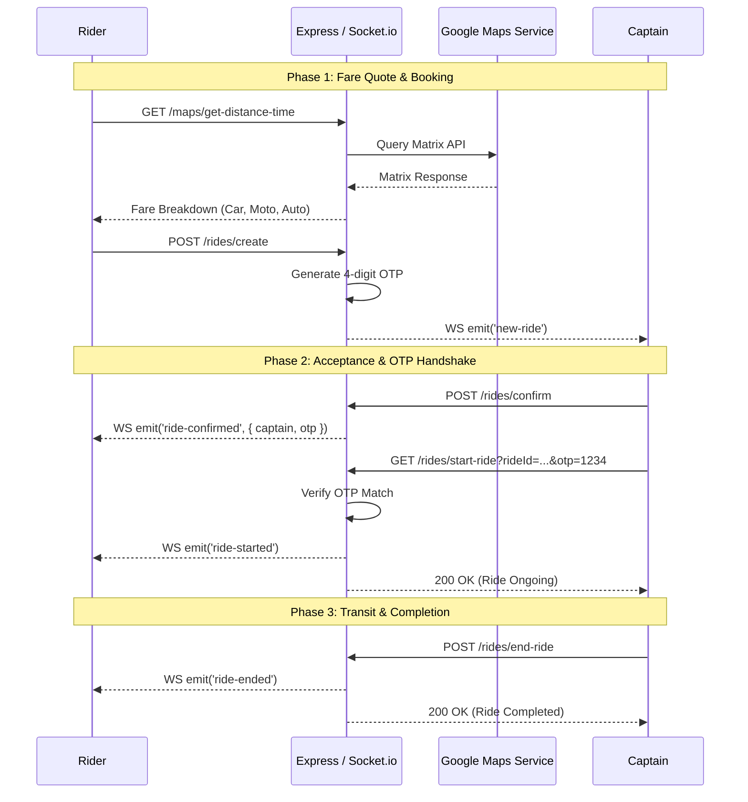

# System Architecture & Scaling to 100x

## End-to-End Request & Event Lifecycle

## Scaling to 100x Load: The First Three Bottlenecks
1. **WebSocket Connection Saturation on Single Node**: A single Node.js instance cannot hold 100,000 concurrent driver WebSocket connections. *Mitigation*: Introduce Redis Pub/Sub Adapter (`@socket.io/redis-adapter`) to distribute connections across an auto-scaling cluster of Node instances.
2. **Google Maps API Rate Limits and Cost Explosion**: Direct external calls for every drag-and-drop autocomplete or distance recalculation will incur astronomical API bills. *Mitigation*: Cache geocoding results and common route distances in Redis with a 24-hour TTL; introduce client-side debouncing on autocomplete inputs.
3. **Database Write Pressure on Driver GPS Updates**: Storing raw GPS coordinate updates to MongoDB on every ping will saturate disk IOPS. *Mitigation*: Store transient driver coordinates in Redis Geospatial indexes (`GEOADD`, `GEORADIUS`) and persist only the final trip polyline to MongoDB upon ride completion.
