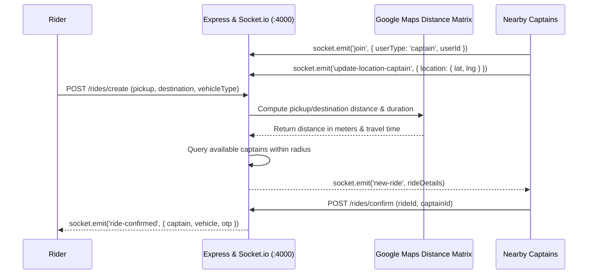

# F1: Real-Time Geospatial Driver-Rider Dispatch & Matching

## 1. Description & Telemetry Flow
Captains log into their portal (`CaptainHome.jsx`) and connect to the central WebSocket server (`socket.js`). As the captain drives, their browser emits `update-location-captain` events with longitude and latitude. When a rider requests a pickup, the server identifies all online captains within the geographic radius and emits a `new-ride` payload directly to their socket rooms.

## 2. Dispatch Sequence Diagram

## 3. Say It Out Loud
"I engineered the real-time driver dispatch engine using Socket.io on top of Express. When a captain goes active, their client establishes a persistent WebSocket connection and joins a designated socket room keyed by their user ID. As they navigate, their device emits location updates that keep their in-memory geospatial coordinates fresh. When a rider creates a ride, the backend calculates the pickup distance and broadcasts a `new-ride` event exclusively to active captains within the proximity radius. I chose WebSockets over HTTP polling because it reduces dispatch latency from seconds to under 50 milliseconds, which is critical for ride-hailing responsiveness."
