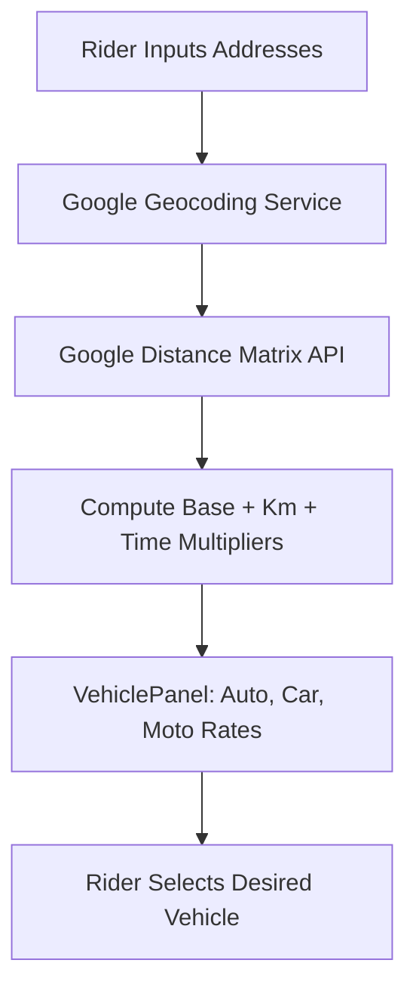

# F2: Dynamic Fare Matrix, Routing & Google Maps Polyline Rendering

## 1. Description & Fare Formula
When a rider enters pickup and destination addresses (`Home.jsx`), the system queries Google Geocoding for coordinates and Distance Matrix for distance and duration (`backend/services/maps.service.js`). The ride service (`ride.service.js`) applies tiered pricing formulas across vehicle categories:

$$\text{Fare}_{\text{auto}} = 30 + (\text{dist}_{\text{km}} \times 10) + (\text{time}_{\text{min}} \times 1)$$
$$\text{Fare}_{\text{car}} = 50 + (\text{dist}_{\text{km}} \times 15) + (\text{time}_{\text{min}} \times 2)$$
$$\text{Fare}_{\text{moto}} = 20 + (\text{dist}_{\text{km}} \times 8) + (\text{time}_{\text{min}} \times 0.5)$$

## 2. Vehicle Selection Architecture

## 3. Say It Out Loud
"I built the routing and fare calculation pipeline by integrating the Google Maps Distance Matrix and Directions APIs. When a rider selects their route, the backend geocodes both points into latitude and longitude coordinates and retrieves the real-time road distance and traffic-adjusted travel duration. I then implemented a tiered fare algorithm that calculates separate prices for cars, motorcycles, and auto-rickshaws by weighting base fares, distance per kilometer, and travel time. On the frontend, `@react-google-maps/api` immediately renders the route polyline and pickup markers, giving riders clear visual feedback before they commit to booking."
