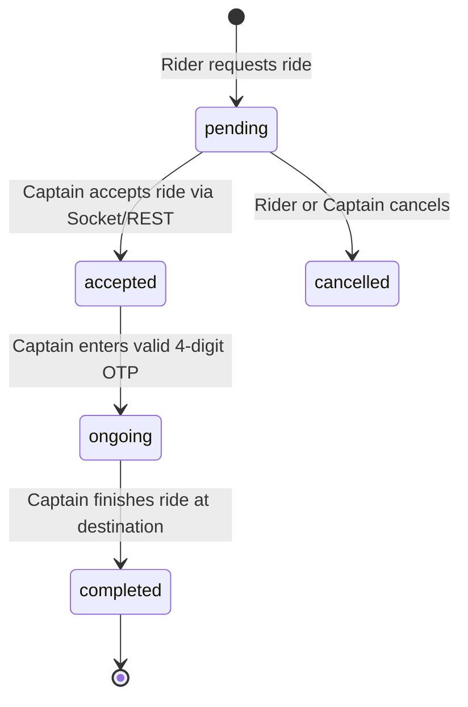

# F3: End-to-End Cryptographic Ride Lifecycle & OTP Handshake

## 1. Description & State Machine
To prevent ride hijacking and ensure the correct passenger enters the vehicle, the system generates a random 4-digit OTP during ride creation (`ride.service.js`). The OTP is revealed only to the rider. When the captain arrives, they must enter this OTP on their interface (`ConfirmRidePopUp.jsx`) before the backend transitions the ride from `accepted` to `ongoing`.

## 2. State Transition Diagram

## 3. Say It Out Loud
"To eliminate passenger mismatch and fraudulent ride claims, I built a cryptographically secured OTP verification handshake. When a ride is created, the server generates a 4-digit numeric code stored alongside the ride document and transmits it only to the rider's device. When the driver arrives, they enter the code into their app, which hits the `/rides/start-ride` endpoint. The server verifies the OTP against the database and, upon a match, transitions the ride status to 'ongoing' while notifying both parties via WebSockets. If an incorrect OTP is entered, the attempt is rejected with an HTTP 400 error, ensuring the vehicle never moves under a false state."
