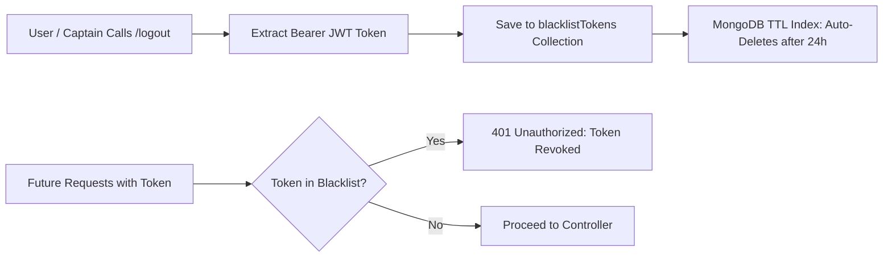

# F4: Dual Persona Identity & Token Blacklisting

## 1. Description & Security Posture
The application enforces strict separation between Riders and Captains (`backend/models/user.model.js` vs `captain.model.js`). Authentication tokens are signed using HS256 JWTs. When a user logs out, their token is saved to a `blacklistTokens` collection with an automated MongoDB TTL index, preventing replay attacks.

## 2. Token Revocation Diagram

## 3. Say It Out Loud
"I architected a dual-persona authentication system that completely segregates rider accounts from commercial driver profiles. Passwords for both roles are hashed with bcrypt using 10 salt rounds. For session management, I implemented a robust token revocation mechanism: upon logout, the JWT is stored in a MongoDB `blacklistTokens` collection equipped with a Time-To-Live (TTL) index set to 24 hours. The authentication middleware checks incoming tokens against this blacklist before decoding, ensuring that logged-out tokens cannot be replayed even if intercepted."
